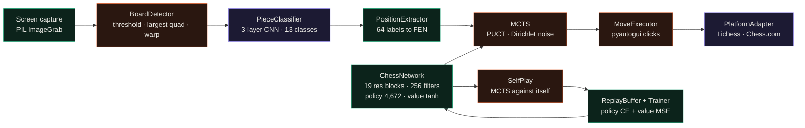
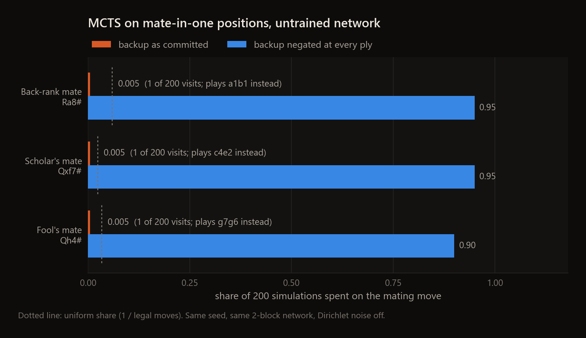
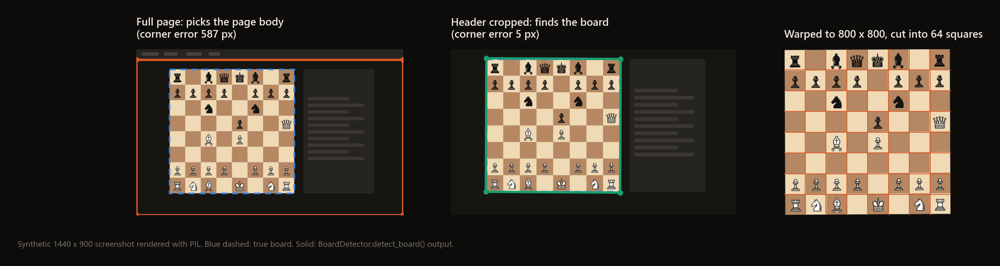

<div align="center">

# chess-ai

**An experimental AlphaZero-style chess agent: policy/value network, MCTS, self-play training, screen-reading board detection and mouse automation, all in Python.**


</div>



<sub>Green: runs and does what it says. Orange: runs, with a known bug or a narrow working range (details below). Purple: scaffolding without the data, weights or site-specific work it needs.</sub>

This is an experiment and isn't finished: the search has a known sign bug and self-play stores the wrong training targets, so it can't learn chess yet (see Limitations).
I started this to see how far I could get toward an agent that learns chess by self-play and then plays on a real
site by reading the screen and moving the mouse, the way a person would. Every stage in the diagram has code, and
the training loop runs end to end. Nothing has been trained yet, and a few bugs keep the pieces from working as a
whole. The sections below show what runs today, measured, and where it breaks.

## Highlights

- The network is a 32.6M-parameter residual tower (19 blocks of 256 filters) over a 19-plane board encoding, with a 4,672-way policy head and a tanh value head.
- MCTS uses PUCT with c = 1.5, 800 simulations per move, Dirichlet noise at the root (α = 0.3, ε = 0.25) and a temperature drop from 1.0 to 0.1 after move 30.
- The training loop (self-play, replay buffer, Adam with step decay, then an arena match that promotes a new model at a 0.55 score) ran end to end for two iterations on a small config in this repo.
- Board detection finds the board to within 5 px on a synthetic page when the board is the largest rectangle on screen, and warps it into 64 square crops.
- A probe on three mate-in-one positions showed the search spending 1 of 200 simulations on the mating move. The backup step negates the value at every second node instead of every node; with a per-ply negation the same untrained network puts 90 to 95% of its visits on the mate.
- The test suite has 70 tests and 51 pass.

---

## How it works

**Board encoding.** `ChessEnvironment.encode_board()` turns a `python-chess` board into 19 planes of 8 × 8: twelve
piece planes (six types, two colours), side to move, four castling planes, en passant and the halfmove clock scaled
to [0, 1]. Moves map to policy indices as `from_square × 64 + to_square`, with promotions in a block after 4,096, so
4,352 of the 4,672 policy outputs are reachable.

**Network.** A 3 × 3 input convolution, 19 residual blocks (two 3 × 3 convolutions with batch norm each) and two heads.
The policy head is a 1 × 1 convolution to 32 channels and a linear layer to 4,672 logits, softmaxed in `forward()`. The
value head is a 1 × 1 convolution, a 256-unit hidden layer and `tanh`. The policy linear layer alone is 9.6M of the
32.6M parameters.

**Search.** `MCTS.search()` expands the root with the network's priors over legal moves (renormalised), mixes in
Dirichlet noise, then runs simulations of select (max Q + U), expand, evaluate and back up. The returned policy is the
root's visit counts raised to 1 / temperature.

**Training.** `Trainer.train()` repeats: 25 self-play games, 10 epochs over the replay buffer (up to 500K positions,
batch 2,048, Adam at 0.01 with weight decay 1e-4, ×0.1 every 20 iterations), then 40 arena games between the new and
the best model. The loss is cross-entropy against the MCTS visit distribution plus MSE on the game result, plus a
small L2 term.

**Vision.** `BoardDetector` grabs the screen, applies an adaptive threshold, and takes the largest contour (between 5%
and 95% of the image) that approximates to a quadrilateral with near-right angles. It orders the corners, warps the
board to 800 × 800 and slices 64 squares. `PieceClassifier` is a three-layer CNN on 64 × 64 crops with 13 classes,
and `PositionExtractor` writes the labels out as FEN and can snap a noisy reading to the closest legal successor of the
previous position.

**Automation.** `MoveExecutor` interpolates square positions between the four board corners and clicks from-square
then to-square with eased mouse moves and a few pixels of jitter. `PlatformAdapter` matches screen templates to spot
the site and whose turn it is, and has a scripted new-game and resign flow for Lichess.

## What runs today

### Search



With an untrained network the priors are close to uniform, so a mate in one should still win the search: the first
visit to the mating move returns a terminal value of -1 for the side that is mated. In `_backpropagate`, the running
value is negated only when a toggle is set, and the toggle flips each step, so the sign changes every second node.
On a two-node path (root, then the mating move) the child keeps the -1, selection maximises Q, and the root never goes
back. Each position got exactly 1 visit out of 200 on the mate. Swapping in a backup that negates once per ply (the
version in `scripts/make_figures.py`) moves the same search to 0.95, 0.95 and 0.90.

### Self-play and the training loop

`python train.py --config config/smoke.yaml --iterations 2` runs the whole loop with a 4-block, 64-filter network and
32 simulations per move. On my RTX 3080, which another training job was using at the same time, it took 13 min 9 s:

| | iteration 1 | iteration 2 |
|---|---|---|
| self-play game | 284 plies in 191.2 s, threefold repetition | 133 plies in 60.8 s, threefold repetition |
| replay buffer | 284 positions | 417 positions |
| loss (policy / value) | 2.135 / 0.856 | 4.224 / 1.000 |
| reported policy top-1 accuracy | 0.762 | 0.681 |
| arena | no previous best, promoted at the default 0.55 | 2 draws, score 0.50, not promoted |

The first game ended in a repetition draw with White a full rook up (king and rook against a bare king). Across four
smoke games, self-play cost 0.44 to 0.67 s per move at 32 simulations. The plotting step at the end fails
because `train.py` calls a `Trainer.get_metrics()` method that doesn't exist; the error is caught and logged.

Two things in `SelfPlay.execute_episode()` would stop real learning even with the search fixed. Every training example
in a game is stored with the policy target of the last position (the `policy_tensor` variable left over from the move
loop), which is why the policy accuracy above looks high after a single game: there is only one target to learn.
The value targets are filled in from the first position onward using the result from the final side-to-move's point
of view. In a decisive game that is only right when Black wins, so every white win is stored with the sign flipped at every position.

### Board detection and position extraction



I rendered a Lichess-like 1440 × 900 page (header bar, brown board, side panel) and passed it to `detect_board()`.
On the full page the largest quadrilateral is the page body under the header, so the detector returns that (587 px
off). With the header cropped away the board is the largest shape and all four corners land within 5 px. The Hough
line fallback in `_find_board_using_hough_lines()` is a stub that returns `None`.

The piece classifier has no weights in the repo and no labelled data to train on. Untrained, its top softmax score on
every square is 0.079 (about 1/13), below the 0.7 threshold, so every square reads as empty and the extracted FEN is
`8/8/8/8/8/8/8/8`. The board-orientation check in `PlatformAdapter` tests whether the bottom-left square is dark, which
is true from both sides of the board (a1 and h8 are both dark), so it reports white in either orientation.

### Tests

| file | tests | pass | main failure causes |
|---|---|---|---|
| `tests/test_core.py` | 24 | 20 | CPU/GPU device mismatch in the save/load test, a mocked model device, a mocked search that keeps returning e2e4 after the pawn has moved |
| `tests/test_vision.py` | 22 | 17 | mocked classifier output that `torch.max` can't take, a FEN test that lists rank 1 first, a placement-only FEN that python-chess accepts |
| `tests/test_automation.py` | 24 | 14 | `if not self.board_coords` on a NumPy array raises in every `execute_move` path; the square-mapping tests catch the mirrored ranks |
| total | 70 | **51** | |

## Quickstart

```bash
git clone https://github.com/EllE961/chess-ai.git
cd chess-ai
pip install -r requirements.txt

python -m pytest tests -q                                   # 51 passed, 19 failed
python scripts/make_figures.py                              # MCTS probe and board-detection figures (CPU, about 20 s)
python train.py --config config/smoke.yaml --iterations 2   # self-play, training and arena on a small network (13 min)
```

`python play.py --color white` and `python main.py --mode play` take over the real mouse and keyboard: the Lichess flow
focuses the address bar, types the URL and clicks fixed screen coordinates. I didn't run either. `cairosvg` (used only
to save board PNGs in debug mode) needs the native cairo library, which Windows doesn't ship.

## Repository map

```text
core/
  chess_environment.py   python-chess wrapper, 19-plane encoding, move <-> policy index
  neural_network.py      residual policy/value network, checkpoint save/load
  mcts.py                PUCT search with Dirichlet root noise and virtual loss
  self_play.py           self-play games to (state, policy, value) examples and PGN records
training/
  data_manager.py        replay buffer and Dataset
  loss_functions.py      policy cross-entropy + value MSE + L2, training metrics
  train_network.py       self-play / train / arena loop with TensorBoard logging
  evaluate.py            arena games between two checkpoints
vision/
  board_detector.py      screen grab, board contour, perspective warp, 64 square crops
  piece_classifier.py    13-class CNN and its training loop
  position_extractor.py  labels to FEN, FEN repair, nearest legal successor
automation/
  move_executor.py       square to screen coordinates, clicks and drag-and-drop
  platform_adapter.py    template matching, turn detection, Lichess new-game and resign
  calibrator.py          board calibration and a square-mapping check image
utils/                   board augmentation, FEN helpers, logging, plots
config/                  hyperparameters.yaml (full size), smoke.yaml (small, for a quick run)
scripts/                 make_figures.py, capture_templates.py, shell wrappers for train/evaluate
tests/                   unit tests for core, vision and automation
docs/                    design notes written alongside the code; they describe the intended system
docs/assets/             figures in this README
main.py · train.py · play.py   entry points
```

## Limitations

- Nothing is trained. There are no network weights, no piece-classifier weights and no labelled square images in the repo.
- The MCTS backup sign (above) has to be fixed before self-play can produce useful targets.
- The self-play examples reuse one policy target per game and store white wins with the wrong value sign.
- Each simulation runs the network twice on the same leaf, once in `_get_policy()` during expansion and once in `_evaluate()`, and `encode_board()` loops over all 64 squares for each of the 12 piece planes in Python. On the small config a self-play move took 0.44 to 0.67 s at 32 simulations; the default 800 simulations on the full network would be far slower.
- Board detection depends on the board being the largest rectangle on screen. Orientation detection always says white.
- `MoveExecutor` raises on its own guard clause. Its corner interpolation also maps a1 to the board's top-left corner pixel on a white-side board: ranks come out mirrored, and the edge files and ranks land on the board border instead of square centres.
- Only Lichess has a scripted flow, and it clicks hard-coded pixel positions. The Chess.com and Chess24 paths return `False`.
- Using engine moves on a normal account breaks the fair-play rules on Lichess and Chess.com. For Lichess, the official Bot API would replace the screen reading and mouse control with a supported interface.

## License

MIT, see [LICENSE](LICENSE).
